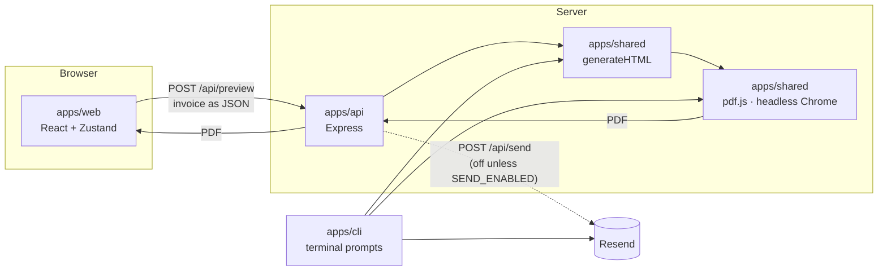

# invoicer

A small invoice generator. Fill in a form (or answer prompts in the terminal) and get a clean PDF invoice, rendered by headless Chrome. It supports English and Spanish, seven currencies, an optional tax ID (RNC, Cédula, RFC, NIT…), saved clients and bank accounts, and emailing the PDF through Resend.

The public demo runs at **[eli7pm.me/invoicer](https://eli7pm.me/invoicer/)**, where emailing is turned off. Links can preselect the language and currency, for example [`eli7pm.me/invoicer/?lang=es&currency=dop`](https://eli7pm.me/invoicer/?lang=es&currency=dop). Both are remembered on later visits.

## How it fits together



- **The browser never builds the invoice HTML.** It sends the form as JSON. The server turns it into HTML with `generateHTML`, escaping every field, then into a PDF with Puppeteer.
- **The CLI calls the same template and PDF code directly,** without the API, for local use with your own Resend key.

## Repository map

```
invoicer/
├── apps/
│   ├── web/                     React app (Vite): the form people use
│   │   ├── index.html           page shell; applies theme and language before first paint
│   │   ├── public/              Louie favicons (shared with eli7pm.me)
│   │   └── src/
│   │       ├── main.jsx         entry: fonts, styles, <App />
│   │       ├── App.jsx          header + form (or the shared invoice view for #i= links) + footer
│   │       ├── config.js        build-time settings (API URL, send on/off, portfolio link)
│   │       ├── i18n.js          all English and Spanish text, tax ID placeholders
│   │       ├── currency.js      currency list, symbols, formatting, tax ID types
│   │       ├── tax-id.js        pure helpers: format a tax ID, keep the cursor in place
│   │       ├── url-params.js    read ?lang= / ?currency= and keep them in sync with the page
│   │       ├── no-autofill.js   attributes that stop browsers and password managers from autofilling
│   │       ├── pdf-api.js       fetchPdf (POST /api/preview), savePdf, file names
│   │       ├── share-link.js    pack an invoice into a link (deflate + base64url) and read it back
│   │       ├── styles.css       eli7pm.me color tokens (light/dark), Geist fonts, layout
│   │       ├── stores/          Zustand stores (see "Web state")
│   │       ├── hooks/           use-t, use-tax-id-input, use-amount-input, use-slow (see "Hooks")
│   │       └── components/
│   │           ├── site-header.jsx      logo, language flags, theme toggle
│   │           ├── invoice-form.jsx     the whole form: meta, parties, tax ID, totals
│   │           ├── saved-field.jsx      text box with Save / Saved (n) / Forget (Bill to, Bank details)
│   │           ├── select.jsx           dropdown (Base UI) that opens next to its button, touch-sized on phones
│   │           ├── date-field.jsx       date button + calendar (react-day-picker) in the page's language
│   │           ├── line-items.jsx       item table (cards on phones)
│   │           ├── logo-upload.jsx      logo picker, 1 MB limit
│   │           ├── invoice-actions.jsx  Preview, Download, WhatsApp, Send (disabled in the demo)
│   │           └── shared-invoice.jsx   what someone sees when they open a shared link
│   ├── api/                     Express server: PDF preview (and optional email)
│   │   └── src/
│   │       ├── index.js         CORS, body limit, /health, error handler, shutdown
│   │       ├── routes/invoice.js  /api/preview and /api/send: validation, rate limit, render
│   │       └── services/        pdf.js, mailer.js (Upstash rate limit + Resend), share-store.js (short links)
│   ├── shared/                  code used by both the API and the CLI
│   │   ├── generateHTML.cjs     the invoice template: labels (en/es), currency, tax ID, escaping
│   │   ├── generateHTML.mjs     ES module re-export of the template
│   │   ├── pdf.js               Puppeteer: one reused browser, network blocked, JS off, timeouts
│   │   └── mailer.js            sends the PDF through Resend
│   └── cli/                     interactive terminal tool (see apps/cli/README.md)
├── scripts/upgrade-image.sh      pnpm image:upgrade (see "Deploying the API")
├── Dockerfile                   API image: Alpine + Node 26 + Chromium
├── render.yaml                  Render service definition (free plan)
├── .env.example                 every environment variable, with defaults
├── .nvmrc                       Node 26 (current LTS)
├── pnpm-workspace.yaml          workspace packages, blocked install scripts, security overrides
└── package.json                 root scripts (dev, web, api), husky + secretlint
```

## Web app (`apps/web`)

### Web state

Shared state lives in four Zustand stores. Each one saves to `localStorage`, so a reload keeps your work.

| Store | File | Saved under | Holds |
| --- | --- | --- | --- |
| `useInvoiceStore` | `stores/invoice-store.js` | `invoicer-draft` | the invoice draft (logo, number, dates, from, tax ID, bill to, line items, bank details, terms), the chosen **currency** (kept when you start over; `?currency=` in the URL wins), and the preview's loading/error state (not saved) |
| `useSavedStore` | `stores/saved-store.js` | `invoicer-saved` | reusable **Bill to** and **Bank details** entries, newest first, up to 20 each |
| `useLocaleStore` | `stores/locale-store.js` | `invoicer-locale` | the language (`en` or `es`). Order of priority: `?lang=` in the URL, then the saved choice, then the browser's language |
| `useThemeStore` | `stores/theme-store.js` | `eli7pm-ui` | light or dark. **Same key as eli7pm.me**, so the theme carries over between the portfolio and the invoicer |

| Action | Store | What it does |
| --- | --- | --- |
| `setField(name, value)` | invoice | updates one field of the draft |
| `setLineItem(id, field, value)`, `addLineItem()`, `removeLineItem(id)` | invoice | edits the line items (there's always at least one) |
| `setCurrency(code)` | invoice | switches currency (ignores codes not in the list) and updates `?currency=` if the URL has it |
| `resetInvoice()` | invoice | starts a blank invoice (keeps the currency and saved entries) |
| `previewPdf()` | invoice | posts the draft to `/api/preview` and returns a `blob:` URL for the PDF. On failure it stores an error **key**, shown in the current language |
| `save(kind, text)`, `remove(kind, text)` | saved | keeps or forgets an entry (`kind` is `billTo` or `bankDetails`); saving one that exists moves it to the top |
| `setLang(lang)` | locale | switches language, sets `<html lang>`, and updates `?lang=` if the URL has it |
| `toggleTheme()` | theme | switches theme, pausing CSS transitions for one frame so nothing flickers |

### Hooks

| Hook | What it does |
| --- | --- |
| `useT()` | returns `{ t, lang }`: the text for the current language |
| `useTaxIdInput()` | everything the tax ID field needs. It reads and writes the draft, formats as you type (`1-01-12345-6` for RNC…), deletes a digit when you backspace over a separator, keeps the cursor in place, and picks the numeric keyboard on phones. Returns `{ typeProps, inputProps }` to spread onto the dropdown and `<input>` |
| `useSlow(loading)` | true once something has been loading for 4 seconds; shows the "waking up the server" note |
| `useAmountInput(value, currency, onChange)` | the price box: groups digits as you type in the currency's own style (`1,234.50` for USD, `1.234,50` for EUR), allows two decimals, keeps the cursor in place, and stores a plain number |

### Features at a glance

- **Languages:** English and Spanish (US and Mexican flags in the header). Covers every label, button and message, and the PDF itself. A link with `?lang=es` opens in Spanish and remembers it for later visits.
- **Currencies:** USD, EUR, DOP first, then CAD, MXN, COP, BRL. Each one is written the way its own country writes it, whatever the page language: `US$1,234.50`, `1.234,50 €`, `RD$1,234.50`, `CA$1,234.50`, `MX$1,234.50`, `COL$1.234,50`, `R$1.234,50`. The format lives in `CURRENCY_LOCALES` (web `currency.js` and the server template).
- **Tax ID (optional):** a type dropdown (RNC, Cédula, RFC, NIT, CNPJ, CPF, BN, EIN, VAT ID, or general) plus the number, formatted per type. Prints under "From" on the PDF.
- **Saved entries:** **Save** next to Bill to or Bank details keeps that text. Once something is saved, a **Saved (n)** dropdown fills the box with it, and **Forget** removes the one showing.
- **Dates:** a calendar in the page's language (weeks start on Monday in Spanish), shown as `9 nov 2026`, stored as `2026-11-09`.
- **PDF:** **Preview PDF** opens it in a new tab; **Download PDF** saves `invoice-<number>.pdf` (`factura-…` in Spanish).
- **WhatsApp:** opens WhatsApp (app or web) with a message like "Factura N.º 12: RD$30,000.00" and a short link such as `eli7pm.me/invoicer/?lang=es&i=k3Xp9qWa`. It works the same on phones and computers.
  - **Phones vs computers:** on phones it opens the WhatsApp app directly (`whatsapp://send`) so the "send to" list appears, falling back to `wa.me` if the app isn't installed. On computers it opens `wa.me` in a new tab.
  - **Your own message (optional):** the "WhatsApp message" box above the buttons adds a line before the summary, like "¡Hola! Aquí tienes la factura de noviembre." It's saved with the draft.
  - **Local links:** on `localhost` the link is written without `http://`.
  - **How it's stored:** the API keeps the invoice in Upstash Redis for **30 days**, and Redis deletes it on its own after that.
  - **The logo** is shrunk to 320×200 before saving.
  - **Fallback:** if the API can't save the link, the button packs the invoice into the link itself after a `#`. That link is longer, and it leaves the logo out if needed.
- **Shared links:** opening a link shows a summary (from, bill to, due date, total) with **View PDF** and **Download PDF**, plus a link to make your own. It doesn't touch the visitor's own draft. A cut-off or edited link shows a "link is incomplete" message.
- **Cold starts:** the page pings the API on load so a sleeping server starts waking early. A preview that takes over 4 seconds shows "Waking up the PDF server…".
- **Send:** grayed out unless the build sets `VITE_SEND_ENABLED=true`.

## API (`apps/api`)

| Endpoint | Body | Response |
| --- | --- | --- |
| `GET /health` | | `{ "ok": true }` (used by the host's health check) |
| `POST /api/preview` | `{ invoice: { … } }` | the PDF (`application/pdf`) |
| `POST /api/share` | `{ invoice: { … } }` | `{ id, expiresAt }`: a short-link code, kept 30 days |
| `GET /api/share/:id` | | `{ invoice }`, or **404** when expired or unknown |
| `POST /api/send` | `{ invoice, recipientEmail }` | `{ success: true }`, or **403** unless `SEND_ENABLED=true` |

**Before rendering, the API checks:**
- Text fields must be strings of at most 2,000 characters, with at most 50 line items.
- The logo must be a PNG, JPEG, GIF or WebP data URL under 1.5 MB, and the whole request must be under 2 MB.
- Currency, language and tax ID type must come from fixed lists. Anything else falls back to USD, English and the general type. The tax ID is at most 40 characters.
- Each field is **HTML-escaped** in the template, so form text can't inject markup into the PDF.

**Rendering protections** (in `shared/pdf.js`):
- JavaScript is turned off in the page being rendered.
- **Every network request is blocked** except inline `data:` images. A crafted invoice can't make the server fetch other addresses (SSRF).
- Each render has a 20-second timeout, and one browser is reused across requests.

**Abuse limits:**
- Each IP gets 30 previews per 10 minutes, and 3 renders can run at once (others get a 503 "busy").
- CORS only answers origins listed in `ALLOWED_ORIGINS`.
- Each IP can create 20 short links per hour. Shared logos must be under 200 KB, and codes have 8 random characters from a 56-character alphabet without look-alikes (`0`/`O`, `1`/`l`/`I`).
- When sending is on, each IP can send 5 emails per hour, tracked in Upstash Redis.

## Shared (`apps/shared`)

| Module | Used by | Exports |
| --- | --- | --- |
| `shared` (`generateHTML.cjs` / `.mjs`) | api, cli | `generateHTML(values)`, `escapeHtml`, `formatMoney`, `CURRENCIES`, `DEFAULT_CURRENCY`, `TAX_ID_TYPES` |
| `shared/pdf` | api, cli | `htmlToPdf(html)`, `closeBrowser()` |
| `shared/mailer` | api, cli | `sendInvoiceEmail({ apiKey, from, pdfBuffer, recipientEmail, invoiceNumber })` |

The web app keeps its own copy of the currency and tax ID lists (`src/currency.js`), because the browser doesn't load the server template. **Keep the two in sync.** To add a currency or tax ID type, change both files and add its name to both languages in `src/i18n.js`.

## Local development

```sh
pnpm install
cp .env.example .env   # only needed for sending email
pnpm api               # API on http://localhost:3100
pnpm web               # web on http://localhost:5174 (or the next free port)
```

- **Ports:** the web app starts on **5174** (set `WEB_PORT` to change it), so the portfolio's "Live demo" link can find it on 5173's neighbor.
- **Use two terminals,** one for `pnpm api` and one for `pnpm web`. The web dev server forwards `/api/*` to port **3100** (set `API_PORT` to change it).
- **The API uses port 3100** because 3000 is often taken by other projects. If the preview returns **502**, the API isn't running.
- **Chrome:** locally, the API uses your installed Google Chrome. Set `PUPPETEER_EXECUTABLE_PATH` to use another Chrome or Chromium.

## Deploying the API

The API runs on **Render's free plan** from `Dockerfile` and `render.yaml`. The free plan has 512 MB of memory and sleeps after 15 minutes without traffic.

- **Image:** two stages on `node:26-trixie-slim` (Debian).
  - **Build stage:** pnpm installs the production dependencies, and Puppeteer downloads **chrome-headless-shell**, Google's server-only Chrome, in the exact version it's tested with.
  - **Final stage:** that Chrome, Liberation fonts, and only the system libraries it needs. npm, yarn and corepack are removed, and it runs as the `node` user.
  - **Library check:** the build fails if Chrome is missing a library, so a broken image never reaches Render.
  - **Linux x86-64 only:** that's the only platform chrome-headless-shell ships for. Render runs on it; on an Apple Silicon Mac, Docker runs the image through emulation, which is slower but fine for testing.
- **Render settings** (in `render.yaml`): `ALLOWED_ORIGINS=https://eli7pm.me`, `SEND_ENABLED=false`, `MAX_CONCURRENT_RENDERS=1` so two Chrome renders never compete for 512 MB, and `/health` as the health check. It only redeploys when the API, shared code, Dockerfile or lockfile change.
- **First deploy:** in Render, choose **New › Blueprint**, pick this repo, and it reads `render.yaml`. It asks for `UPSTASH_REDIS_REST_URL` and `UPSTASH_REDIS_REST_TOKEN`; copy them from a free Upstash Redis database (Console › your database › REST API).

### Keeping Chrome up to date

```sh
pnpm image:upgrade
```

This updates dependencies within their version ranges and runs `pnpm audit`. **Chrome's version comes from Puppeteer,** so a Puppeteer update is what brings a newer Chrome. It then rebuilds the image from scratch with the newest Debian and Node 26 security updates, and prints the Chrome version and image size. Finally it renders a test PDF with Render's limits (512 MB, 0.1 CPU).

To finish, commit and push any changes, then in Render choose **Manual Deploy › Clear build cache & deploy**. With `RENDER_API_KEY` and `RENDER_SERVICE_ID` set, the script starts that deploy itself.

## GitHub Actions

| Workflow | When | What it does |
| --- | --- | --- |
| `ci.yml` (Checks) | every pull request and push to `master` | installs, lints and builds the web app, syntax-checks the API, shared code and CLI, and runs `pnpm audit --prod` |
| `publish-demo.yml` (Publish demo) | push to `master` that touches `apps/web`, `apps/shared` or the lockfile, or by hand | starts eli7pm.me's deploy, which rebuilds the demo at `/invoicer/` |

- **Publish demo needs a secret:** `PORTFOLIO_DISPATCH_TOKEN`, a fine-grained GitHub token with **Actions: read and write** on `eli7pm/eli-portfolio` only.
- **The API deploys separately:** Render redeploys it on its own when `apps/api`, `apps/shared`, the `Dockerfile` or the lockfile change on `master`.

## Environment variables

**API** (`.env` or the host's settings):

| Variable | Default | Purpose |
| --- | --- | --- |
| `PORT` | `3100` | port to listen on (hosts usually set this) |
| `ALLOWED_ORIGINS` | `http://localhost:5173` | comma-separated origins allowed by CORS |
| `SEND_ENABLED` | `false` | `true` turns on `POST /api/send` |
| `MAX_CONCURRENT_RENDERS` | `3` | Chrome renders allowed at once (`1` on Render) |
| `PUPPETEER_EXECUTABLE_PATH` | your Mac's Chrome | Chrome or Chromium binary |
| `UPSTASH_REDIS_REST_URL`, `UPSTASH_REDIS_REST_TOKEN` | | storage for short links (and email rate limits). Without them, links live in memory and vanish on restart, which is fine for local development |
| `EMAIL_USER`, `RESEND_API_KEY` | | only when sending: sender address and Resend key |

**Web build** (set when running `vite build`):

| Variable | Default | Purpose |
| --- | --- | --- |
| `BASE_PATH` | `/` | URL path the app is served from (`/invoicer/` on eli7pm.me) |
| `VITE_API_URL` | same origin | where the API lives, e.g. `https://<your-api>.up.railway.app` |
| `VITE_SEND_ENABLED` | `false` | `true` enables the Send button and email field |
| `VITE_PORTFOLIO_URL` | `https://eli7pm.me/` (`http://localhost:5173/` in dev) | where the logo links |

## Dependencies and security

- **Node 26** (current LTS) and **pnpm 12**, pinned in `package.json` and `.nvmrc`.
- **`pnpm audit` reports no known vulnerabilities.** `pnpm-workspace.yaml` overrides `minimatch` (pulled in by ESLint) to a patched version.
- **pnpm 12 blocks install scripts** unless you allow them. `allowBuilds: puppeteer: false` skips Puppeteer's Chrome download on purpose, because the API uses an installed Chrome (or the Docker image's Chromium).
- **Secrets can't be committed by accident:** a husky pre-commit hook runs **secretlint** on every commit.
